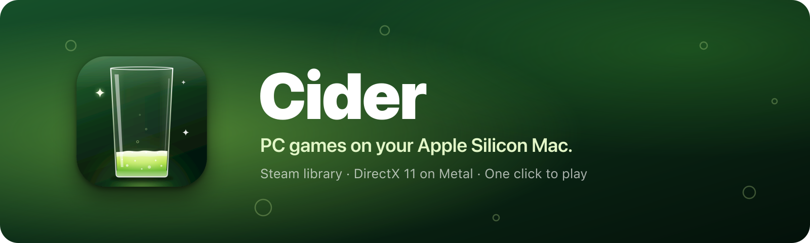
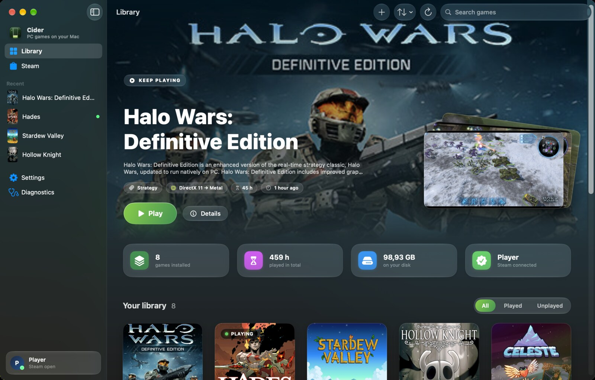
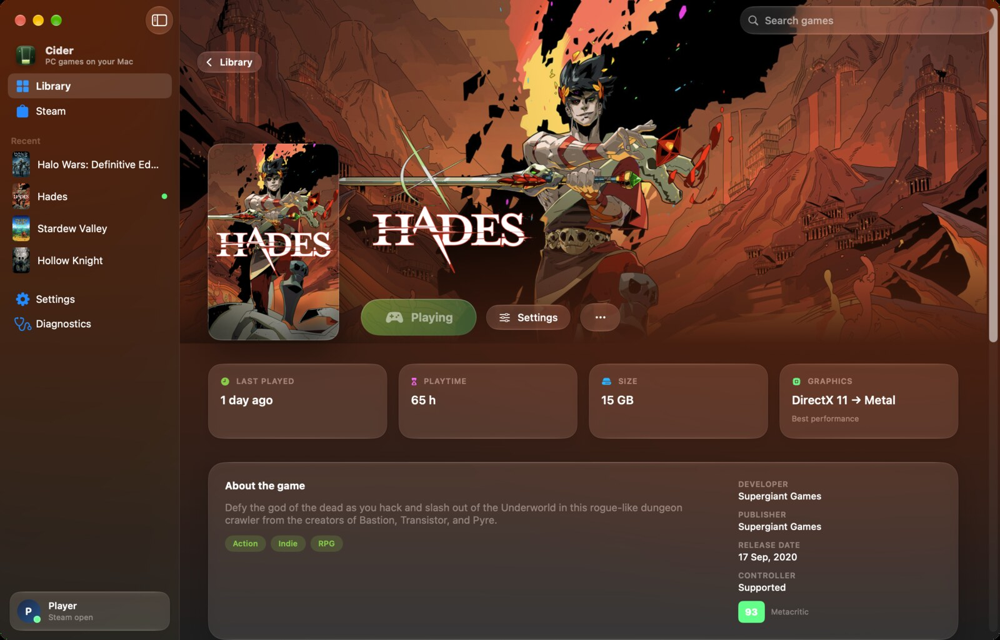
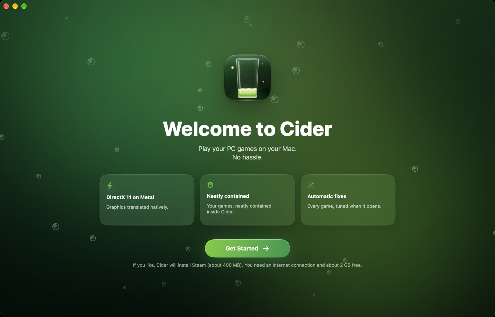
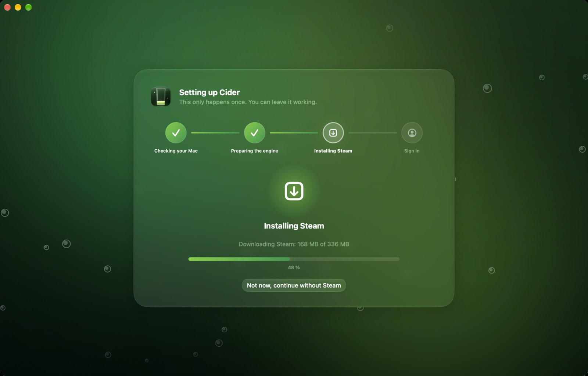
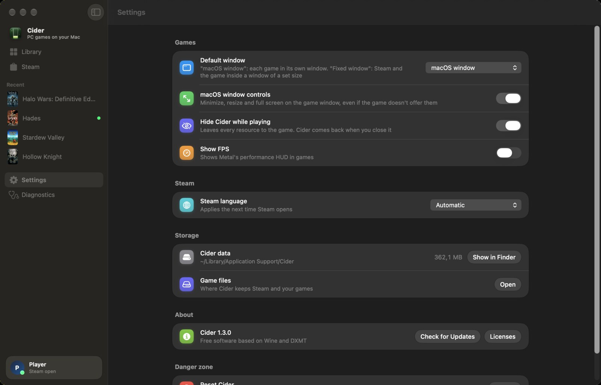
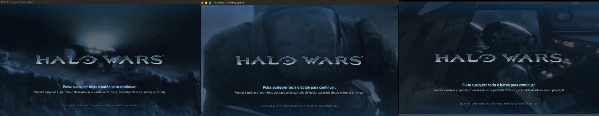

<p align="center">
  
</p>

<p align="center">
  <a href="https://github.com/alexlahoz/cider/releases/latest"></a>
  
  
  
  <a href="LICENSE"></a>
</p>

**Cider** is a native macOS app that lets you play the PC games in your Steam library on Apple Silicon Macs — no virtual machines, no command line, no tinkering. Install it, sign in to Steam (or skip it and add your own games), and press **Play**.

Under the hood Cider bundles a tuned [Wine](https://www.winehq.org) runtime and [DXMT](https://github.com/3Shain/dxmt), which translates Direct3D 10/11 to Apple's Metal. Everything is free and open source.

<p align="center">
  
</p>

## Features

- **A real Mac app.** Built in SwiftUI with Liquid Glass on macOS 26 and translucent materials on macOS 14–15. English and Spanish.
- **Guided first run.** Checks your Mac, installs Rosetta 2 if needed, prepares the game engine and — optionally — downloads and installs the official Steam client from Valve.
- **Your Steam library, beautifully.** Covers, hero art, logos, descriptions and screenshots, playtime and last played, live "Playing" status.
- **Games from outside Steam.** Add any PC game `.exe` (button, drag and drop, or *Open With → Cider*) or run an installer and let Cider find the game it installed.
- **Plays nicely with macOS.** Every game opens in a normal macOS window — minimize, resize and full screen with the green button — even games that only offer a fixed-size or borderless window.
- **Render resolution.** Render at 75, 67 or 50 % and let macOS upscale: big FPS gains on 4K/5K displays.
- **Automatic per-game fixes.** Native DLL overrides where games need them, windowed launch for Unity/Unreal/Source titles, anti-cheat-free launch for games that offer it (e.g. *Halo: The Master Chief Collection*).
- **In-app updates.** Cider checks GitHub Releases, downloads the new version and replaces itself.

| | |
|---|---|
|  |  |
|  |  |

## Requirements

- A Mac with **Apple silicon** (M1 or later).
- **macOS 14 Sonoma** or later.
- About 2 GB of free space plus your games, and an Internet connection for the first run.

## Install

1. Download **`Cider-x.y.z.dmg`** from the [latest release](https://github.com/alexlahoz/cider/releases/latest).
2. Open it and drag **Cider** to **Applications**.
3. Cider is not notarized by Apple yet, so the first launch is blocked: open Cider once, then go to **System Settings → Privacy & Security** and click **Open Anyway**.
4. Follow the assistant. Steam is optional — choose *Not now, continue without Steam* to only use games you add yourself.

From then on, Cider updates itself: when a new version is out you'll see it in the sidebar.

## Compatibility

| Works | Doesn't work (yet) |
|---|---|
| Direct3D 10 / 11 (64-bit) → Metal via DXMT | Direct3D 12 |
| Direct3D 8 / 9 → OpenGL via wined3d | Kernel-level anti-cheat (EasyAntiCheat / BattlEye in kernel mode, Vanguard…) |
| Vulkan → Metal via MoltenVK | Intel Macs |

Tested end to end with **Halo Wars: Definitive Edition** and **Halo: The Master Chief Collection** (anti-cheat disabled mode).

<p align="center">
  
  <br><sub>Halo Wars in a regular macOS window: windowed, resized and in full screen.</sub>
</p>

## How it works

```
Cider.app (SwiftUI)
 ├─ Engine/        Swift layer: prefix setup, Steam manager, game launcher, updater
 └─ Resources/runtime/
     ├─ wine/      Wine 11.21 (Gcenx build) + patched winemac.so + DXMT as builtin d3d11/dxgi
     ├─ steamwebhelper.exe   wrapper that makes Steam's CEF browser render under Wine
     └─ licenses/  third-party notices and the patches applied
```

- **Wine** runs the PC game; a private prefix lives in `~/Library/Application Support/Cider/`.
- **winemac.so** is rebuilt from the Wine 11.21 sources with visible symbols (needed by DXMT) and four small patches in [`patches/wine`](patches/wine): macOS window controls on game windows, a configurable render scale, and two fixes for scaled full-screen rendering.
- **DXMT** is built from [`notpop/dxmt@924a607`](https://github.com/notpop/dxmt) plus the patches in [`patches/dxmt`](patches/dxmt).
- **Steam** is never bundled: Cider downloads the official installer from Valve. Its embedded browser runs through a tiny wrapper ([`runtime-src/steamwebhelper`](runtime-src/steamwebhelper)) in single-process, software mode — otherwise it paints black under Wine.

## Building from source

You need Xcode (with the Metal Toolchain: `xcodebuild -downloadComponent MetalToolchain`), Python 3 and, from Homebrew, `mingw-w64 bison flex cmake ninja librsvg`.

```sh
make release   # runtime → Cider.app → dist/Cider-<version>.dmg
```

| Command | What it does |
|---|---|
| `make runtime` | Downloads the Gcenx Wine build (SHA-256 pinned), rebuilds `winemac.so`, builds DXMT and the Steam web-helper wrapper, collects licenses into `build/runtime`. Everything is cached in `third_party/`. |
| `make app` | Builds the Swift package (Release, arm64), assembles `build/Cider.app` with the runtime and signs it ad hoc. |
| `make dmg` | Packs `dist/Cider-<version>.dmg` with a background and an Applications shortcut. |
| `make publish` | Tags `v<version>` and uploads the DMG as a GitHub release (requires `gh`). |

DXMT needs an x86_64 build of LLVM 15, which takes ~30 minutes the first time. To reuse existing toolchains, copy `scripts/local.env.example` to `scripts/local.env` and point it at them.

Useful while developing: `CIDER_RUNTIME=build/runtime` and `CIDER_DATA_DIR=/some/folder` change where Cider looks for its runtime and data; `-CiderDemo YES` shows a sample library; `CIDER_UPDATE_FEED=file:///path/feed.json` tests updates against a local release feed.

### Localization

Source strings are English. Spanish lives in [`scripts/l10n/es.py`](scripts/l10n/es.py) and is the app's default language. After changing UI text:

```sh
scripts/l10n/extract.sh > /tmp/keys.json && scripts/l10n/generate.py /tmp/keys.json
```

## Credits

Cider stands on the shoulders of:

- [Wine](https://www.winehq.org) and the [Gcenx macOS Wine builds](https://github.com/Gcenx/macOS_Wine_builds)
- [DXMT](https://github.com/3Shain/dxmt) by Feifan He, and the [notpop fork](https://github.com/notpop/dxmt)
- [MoltenVK](https://github.com/KhronosGroup/MoltenVK) and [LLVM](https://llvm.org)

## License

Cider's own code (app, scripts and the web-helper wrapper) is released under the [MIT License](LICENSE). The bundled runtime keeps its own licenses — Wine is LGPL-2.1-or-later, DXMT is MIT, LLVM is Apache-2.0 with LLVM exception, MoltenVK is Apache-2.0. See [`licenses/NOTICE.md`](licenses/NOTICE.md) for details, exact sources and the patches applied.

Steam is a trademark of Valve Corporation. Windows and DirectX are trademarks of Microsoft. Halo is a trademark of Microsoft. Cider is an independent project and is not affiliated with Valve, Microsoft or Apple.
